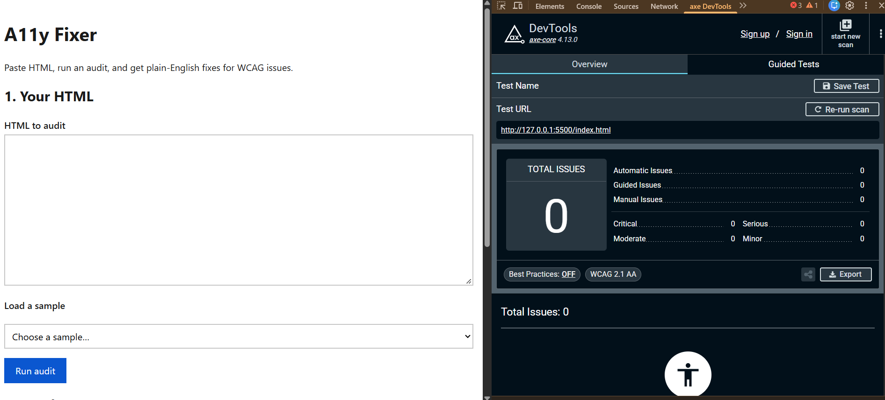
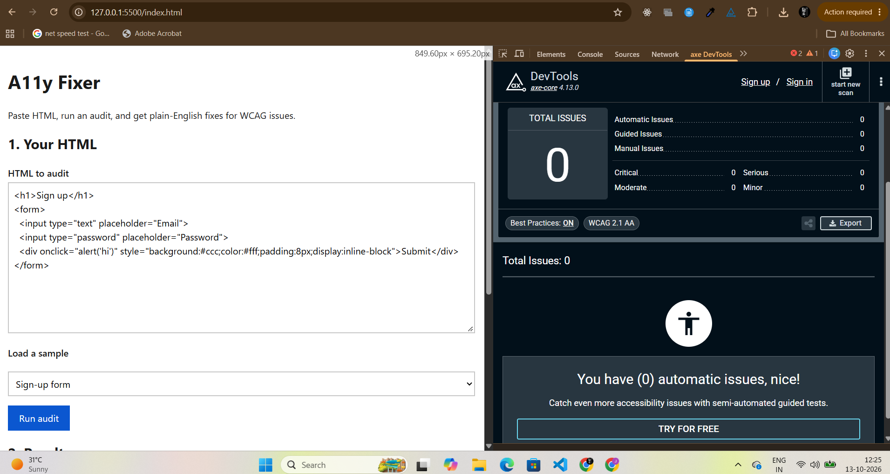
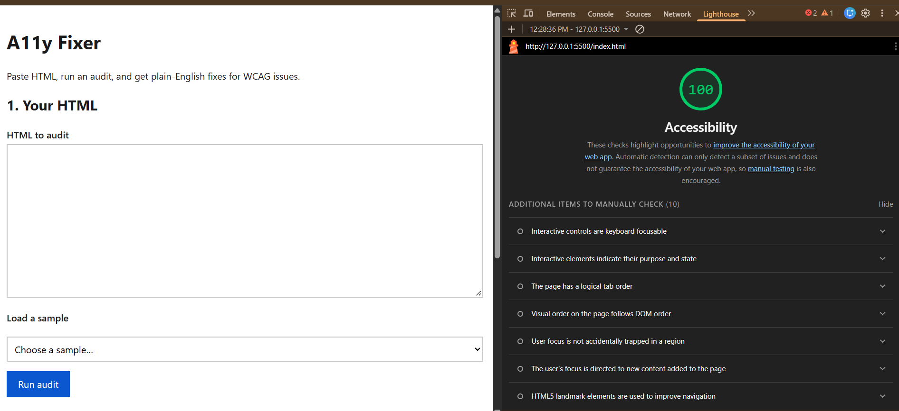

# A11y Fixer

**A web accessibility audit tool that tells developers what's wrong, why it matters, and how to fix it.**

Paste any HTML, run an audit, and get plain-English fixes with before/after code,
mapped to WCAG success criteria. It also catches problems that automated tools
miss, such as placeholder-only form fields and clickable `
` "buttons".

**[Live demo](https://YOUR-USERNAME.github.io/a11y-fixer/)** | Built with HTML, CSS, JavaScript and axe-core

## Why I built it

Automated scanners are good at finding some issues, but they report them in
technical language and miss others entirely. I wanted a tool that does three things:

1. Explains each issue the way a developer or designer can act on it
2. Shows corrected code next to the failing code
3. Covers the gaps automated testing leaves, with instructions for checking by hand

## What it does

| Feature | Details |
|---|---|
| Automated audit | Runs axe-core on pasted HTML and lists each violation with impact and WCAG criterion |
| Plain-English fixes | A rule-to-remediation dictionary I wrote, with a before/after code comparison |
| Manual checks | Heuristic checks for what axe misses (listed below) |
| Test by hand | Every manual finding includes steps for confirming it with keyboard or screen reader |
| Built-in samples | Sample pages with deliberate accessibility bugs for demos |

**Manual checks cover:**
- Form fields that use a placeholder instead of a label (WCAG 1.3.1, 3.3.2)
- Clickable `
`/`` elements that aren't keyboard accessible (2.1.1, 4.1.2)
- Vague link text such as "Click here" (2.4.4)
- Skipped heading levels (1.3.1, 2.4.6)
- Removed focus outlines (2.4.7)
- Data tables with no header cells (1.3.1)
- Possible color-only meaning (1.4.1)

## What automated tools miss (a real example)

On the sample sign-up form, axe reported 5 issue types: contrast, missing page
title, missing language, and two landmark issues. It did **not** flag the
placeholder-only email and password inputs, or the `
` acting as the
Submit button. The manual checks caught both. This is the gap the tool is built around.

## How I tested the tool itself

An accessibility tool should be accessible, so I tested it three ways.

**1. axe DevTools** (WCAG 2.1 AA, best practices on): 0 issues, both on the empty page and after running an audit.

| Before running an audit | After running an audit |
|---|---|
|  |  |

**2. Lighthouse** accessibility score: 100 (automated checks only).

**3. Keyboard-only walkthrough.** Tab order follows the visual order (skip link,
textarea, sample dropdown, Run audit button). The focus outline is visible on every
control, and the audit runs with Enter.

## Problems I found and fixed

- **Keyboard access to code blocks:** the scrollable `<pre>` code boxes in the
  results couldn't be reached by keyboard. I made them focusable with `tabindex="0"`
  and added accessible labels.
- **axe version mismatch:** the axe DevTools extension crashed when scanning the
  page because it ran a different axe-core version from the one loaded in my
  preview iframe. I aligned the versions.

## Limitations

- Manual checks are heuristics. They only see inline event handlers, not listeners
  added with `addEventListener`, and the color-only check is a "review manually" flag.
- Automated testing covers only part of WCAG. A clean result doesn't mean a page is
  fully accessible, so manual and screen reader testing are still needed.

## Run it locally

1. Clone the repo
2. Open `index.html` with Live Server in VS Code (or any local web server)
3. Pick a sample or paste your own HTML, then click **Run audit**

## Tech

HTML, CSS, vanilla JavaScript, [axe-core](https://github.com/dequelabs/axe-core), WCAG 2.1/2.2

## Author

**Donga Jyoshna**: [LinkedIn](YOUR-LINKEDIN-URL) | jyoshna.d.n@gmail.com